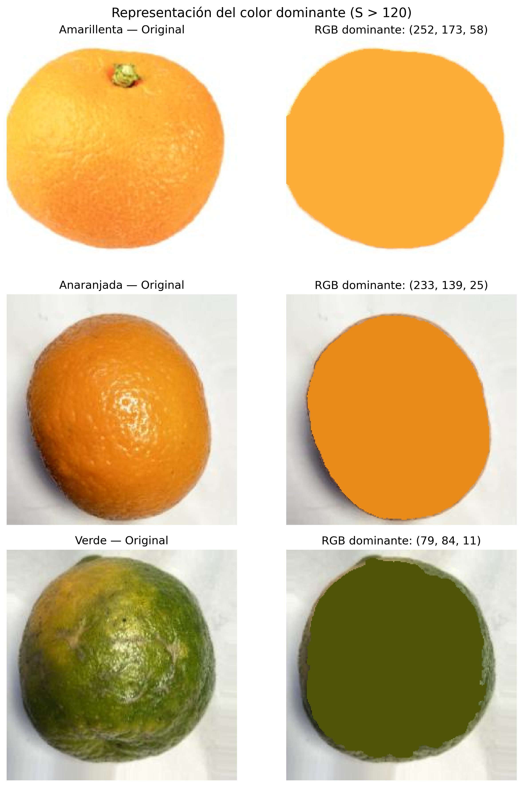
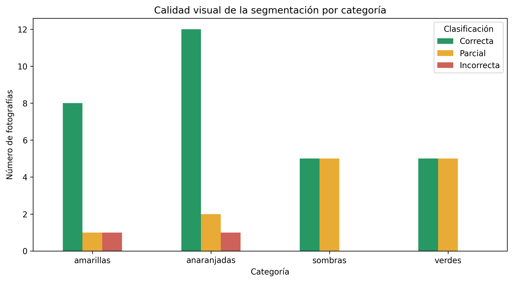

# Detección de naranjas y análisis del color dominante

**Proyecto final — Procesamiento Digital de Imágenes**

**Autor:** Camilo Eduardo Muñoz Albornoz  
**Universidad:** Universidad Tecnológica de Pereira  
**Lenguaje:** Python  
**Tecnologías:** OpenCV, NumPy, Matplotlib, pandas y Jupyter Notebook

## Resumen

Este proyecto implementa un método clásico de visión por computador para
segmentar naranjas en fotografías y caracterizar el color de la región
detectada. El procedimiento no utiliza entrenamiento ni modelos de
aprendizaje automático: combina suavizado gaussiano, segmentación en HSV,
operaciones morfológicas, detección de contornos y cuantización RGB.

El notebook final ajusta el umbral del canal de saturación a `S > 120`,
selecciona el contorno exterior de mayor área y calcula, para la región
segmentada, el RGB promedio, el intervalo RGB dominante y el porcentaje de
píxeles perteneciente a dicho intervalo. También genera una visualización en
la que la naranja se repinta con su color dominante y el fondo se conserva.

## Descripción

El proyecto delimita la región de interés (ROI) de la fruta a partir de su
máscara binaria y estima sus características cromáticas. La selección del
contorno de mayor área supone que la naranja es el objeto principal de cada
fotografía.

El alcance se limita a la segmentación y caracterización del color. El
algoritmo no determina el grado de madurez, no diagnostica enfermedades y no
clasifica automáticamente la calidad comercial de la fruta.

## Objetivos

**Objetivo general**

Desarrollar un algoritmo capaz de identificar el contorno de una naranja y determinar su color RGB promedio y dominante a partir de imágenes digitales.

**Objetivos específicos**

- Implementar técnicas de preprocesamiento y filtrado espacial.
- Segmentar la fruta utilizando el canal de saturación HSV.
- Aplicar operaciones morfológicas para mejorar la máscara binaria.
- Detectar el contorno principal y construir una región de interés.
- Calcular el color RGB promedio y el intervalo RGB más frecuente.
- Representar visualmente la fruta utilizando el color dominante.
- Evaluar el procedimiento con fotografías de diferentes tonalidades y condiciones de iluminación.

## Estructura del proyecto

```text
.
├── analisis_naranjas.ipynb             # Notebook de exploración
├── analisis_naranjas_final.ipynb       # Notebook reproducible principal
├── readme.md
├── dataset/
│   ├── desarrollo/
│   │   ├── naranja01.jpg
│   │   ├── naranajaSombra.png
│   │   └── 3 fotografías del conjunto público
│   └── evaluacion/
│       ├── amarillas/
│       ├── anaranjadas/
│       ├── sombras/
│       └── verdes/
├── resultados/
│   ├── *.csv
│   ├── *.png
├── doc/
│   ├── main.tex
│   └── main.pdf
└── example.txt
```

El notebook final debe ejecutarse desde esta carpeta. Los archivos CSV y las
figuras de `resultados/` se generan o actualizan durante la ejecución.

## Conjunto de datos

Se utilizaron **50 fotografías**, distribuidas de la siguiente manera:

| Conjunto | Cantidad | Propósito |
|---|---:|---|
| Desarrollo | 5 | Implementación y selección de parámetros |
| Evaluación | 45 | Evaluación del algoritmo |
| **Total** | **50** | |

Las 45 fotografías de evaluación se organizaron en cuatro grupos:

| Categoría | Fotografías |
|---|---:|
| Amarillas | 10 |
| Anaranjadas | 15 |
| Con sombras | 10 |
| Verdes | 10 |

De las 50 fotografías, 48 fueron seleccionadas del conjunto público [Orange Fruit Image Dataset for Classification — Mendeley Data](https://data.mendeley.com/datasets/zk4hzhtcdd/2).

Las otras dos imágenes, `naranja01.jpg` y `naranajaSombra.png`, se obtuvieron de fuentes disponibles en internet y se utilizaron únicamente durante el desarrollo.

## Metodología

El procesamiento se desarrolla mediante las siguientes etapas:

```text
Imagen de entrada
       |
       v
Lectura y conversión BGR a RGB
       |
       v
Redimensionamiento de la imagen
       |
       v
Filtro gaussiano 5 × 5
       |
       v
Conversión RGB a HSV
       |
       v
Umbralización del canal S
       |
       v
Cierre morfológico 5 × 5
       |
       v
Extracción del contorno principal
       |
       v
Construcción de la ROI
       |
       v
Cálculo del RGB promedio
       |
       v
Cuantización RGB y grupo dominante
       |
       v
Repintado de la fruta
```

### 1. Preprocesamiento

Las fotografías se leen mediante OpenCV y se convierten de BGR a RGB.

Cuando es necesario, se redimensionan conservando su relación de aspecto, con un máximo de 800 píxeles en el lado mayor.

Posteriormente se aplica un filtro gaussiano con núcleo de 5 × 5 para suavizar pequeñas variaciones locales.

### 2. Segmentación HSV

La imagen suavizada se convierte al espacio HSV y se utiliza el canal de saturación (`S`) para generar una máscara binaria.

Se aplica la condición:

```python
S > 120
```

Los píxeles que superan el umbral se representan en blanco y los restantes en negro.

Inicialmente se trabajó con un umbral de 50. Posteriormente, se compararon los valores 50, 80, 100, 120, 140, 160, 180 y 200 sobre las cinco fotografías de desarrollo.

Se seleccionó **120** como umbral definitivo por ofrecer un equilibrio visual favorable entre conservar la fruta y excluir algunas regiones del fondo.

### 3. Operaciones morfológicas

Se aplica un cierre morfológico con elemento estructurante elíptico de 5 × 5.

Esta operación combina dilatación y erosión para corregir pequeñas discontinuidades de la máscara.

### 4. Extracción del contorno

Mediante `cv2.findContours()` se identifican los contornos exteriores de la máscara binaria.

Se selecciona el contorno de mayor área, suponiendo que la naranja es el objeto principal de la fotografía.

El contorno seleccionado se rellena para construir la región de interés o ROI.

### 5. RGB promedio y cuantización

El color RGB promedio se obtiene calculando la media de los tres canales sobre todos los píxeles seleccionados.

Para determinar el color dominante se utiliza **cuantización uniforme RGB**, dividiendo los valores de cada canal en intervalos de 32 niveles.

Cada canal contiene ocho grupos posibles:

```text
Grupo 0:   0–31
Grupo 1:  32–63
Grupo 2:  64–95
Grupo 3:  96–127
Grupo 4: 128–159
Grupo 5: 160–191
Grupo 6: 192–223
Grupo 7: 224–255
```

Al combinar los tres canales se obtienen:

**8 × 8 × 8 = 512 grupos RGB posibles.**

El algoritmo cuenta los píxeles de cada grupo y selecciona el más frecuente. Después calcula un RGB representativo promediando los valores originales de los píxeles que pertenecen a dicho grupo.

El porcentaje dominante corresponde a la proporción de píxeles de la ROI incluidos en ese intervalo.

### 6. Representación final

La ROI se repinta con el RGB dominante calculado, manteniendo sin modificaciones el fondo de la fotografía.

## Resultados

Las 45 fotografías de evaluación fueron procesadas con el umbral definitivo `S > 120`.

La segmentación fue valorada mediante inspección visual, obteniendo los siguientes resultados:

| Categoría | Correcta | Parcial | Incorrecta | Total |
|---|---:|---:|---:|---:|
| Amarillas | 8 | 1 | 1 | 10 |
| Anaranjadas | 12 | 2 | 1 | 15 |
| Sombras | 5 | 5 | 0 | 10 |
| Verdes | 5 | 5 | 0 | 10 |
| **Total** | **30** | **13** | **2** | **45** |

- **66,7 %:** segmentaciones visualmente correctas.
- **28,9 %:** segmentaciones parciales.
- **4,4 %:** segmentaciones incorrectas.

Estos porcentajes corresponden a una **clasificación visual por fotografía**, no a una métrica de exactitud calculada a nivel de píxel.

### Resultados del color dominante

Se seleccionaron tres fotografías representativas del conjunto de evaluación:

| Fotografía | RGB dominante | Grupo RGB | Intervalo RGB (R / G / B) | Porcentaje |
|---|---|---|---|---:|
| Amarillenta | (252, 173, 58) | (7, 5, 1) | 224–255 / 160–191 / 32–63 | 28,93 % |
| Anaranjada | (233, 139, 25) | (7, 4, 0) | 224–255 / 128–159 / 0–31 | 23,55 % |
| Verde | (79, 84, 11) | (2, 2, 0) | 64–95 / 64–95 / 0–31 | 16,17 % |



*Comparación de las fotografías originales y sus representaciones mediante el color RGB dominante.*

### Calidad de segmentación



*Distribución de los resultados de la evaluación visual de las 45 fotografías.*

## Instalación y ejecución

### Requisitos

- Python 3.
- Jupyter Notebook o Visual Studio Code con extensión Jupyter.
- OpenCV.
- NumPy.
- Matplotlib.
- pandas.

### Instalación de dependencias

Desde una terminal ubicada en `deteccion_colores_naranjas/`, ejecutar:

```bash
python -m pip install opencv-python numpy matplotlib pandas jupyter
```

### Ejecutar el proyecto

1. Clonar o descargar el repositorio.
2. Abrir una terminal en `deteccion_colores_naranjas/`.
3. Instalar las dependencias indicadas arriba.
4. Abrir `analisis_naranjas_final.ipynb` en Jupyter Notebook o Visual Studio
   Code con la extensión Jupyter.
5. Seleccionar el entorno de Python donde se instalaron las dependencias.
6. Ejecutar todas las celdas en orden mediante **Restart Kernel and Run All
   Cells**.

Es importante conservar las carpetas `dataset/desarrollo/`,
`dataset/evaluacion/` y `resultados/` en la ubicación esperada. El notebook
contiene el desarrollo paso a paso, la comparación de umbrales, la evaluación
y la generación de tablas y gráficas.

Los principales archivos generados son:

- `resultados_desarrollo.csv` y `resultados_desarrollo.png`: métricas y
  visualizaciones del conjunto usado para ajustar el procedimiento.
- `resultados_evaluacion.csv`: resultados por imagen del conjunto de
  evaluación.
- `contornos_*.png`: contornos detectados para cada categoría.
- `calidad_segmentacion.png` y `porcentaje_dominante.png`: resúmenes de la
  evaluación.
- `comparacion_colores_final.png`: comparación de imágenes originales y
  repintadas con el color dominante.

## Limitaciones

El algoritmo presenta algunas limitaciones:

- **Sombras:** pueden quedar conectadas con la región segmentada.
- **Hojas:** pueden superar el umbral de saturación y ser incluidas en el contorno.
- **Naranjas verdes:** algunas zonas de baja saturación pueden quedar fuera de la máscara.
- **Contorno principal:** seleccionar la región de mayor área no garantiza identificar correctamente la fruta en todas las fotografías.
- **Iluminación:** los valores RGB dependen de las condiciones en que se capturó la imagen.
- **Evaluación:** la revisión visual no sustituye una evaluación cuantitativa con máscaras de referencia.

## Trabajo futuro

Se proponen las siguientes mejoras:

- **HSV multicanal:** combinar tono, saturación y luminosidad para la segmentación.
- **K-Means:** explorar agrupaciones de color basadas en similitud, sin intervalos RGB fijos.
- **CIELAB:** estudiar diferencias cromáticas más cercanas a la percepción humana.
- **GrabCut:** explorar una segmentación más robusta frente a fondos complejos.
- **IoU y Dice:** comparar las máscaras obtenidas con segmentaciones de referencia para medir cuantitativamente la calidad del procedimiento.

## Referencias

1. R. C. Gonzalez y R. E. Woods, *Digital Image Processing*, 4.ª edición, Pearson, 2018.
2. P. Ganesh, K. Volle, T. F. Burks y S. S. Mehta, “Deep Orange: Mask R-CNN based Orange Detection and Segmentation”, *IFAC-PapersOnLine*, 2019. DOI: [10.1016/j.ifacol.2019.12.499](https://doi.org/10.1016/j.ifacol.2019.12.499).
3. A. A. Shuvo y colaboradores, “EinsteinNet and state-of-the-art ML models for android-based orange classification: Integration, evaluation, and deployment”, *Smart Agricultural Technology*, 2025. DOI: [10.1016/j.atech.2025.101072](https://doi.org/10.1016/j.atech.2025.101072).
4. [OpenCV — Documentación oficial](https://docs.opencv.org/4.x/).
5. [Orange Fruit Image Dataset for Classification — Mendeley Data](https://doi.org/10.17632/zk4hzhtcdd.2).

## Autor

**Camilo Muñoz**  
Universidad Tecnológica de Pereira  
Proyecto final de la asignatura Procesamiento Digital de Imágenes — 2026.
